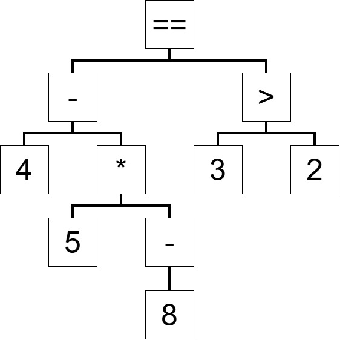

 # Lab 3

 ### Expression Grammar
 ```
expression     → equality ;
equality       → comparison ( ( "!=" | "==" ) comparison )* ;
comparison     → term ( ( ">" | ">=" | "<" | "<=" ) term )* ;
term           → factor ( ( "-" | "+" ) factor )* ;
factor         → unary ( ( "/" | "*" | "//" | "%" ) unary )* ;
unary          → ( "!" | "-" ) unary
                | primary ;
primary        → NUMBER | STRING | "true" | "false" | "nil"
                | "(" expression ")" ;
```

This expression grammar is equivalent to the one implentmented in Lox, except for my additional '//' and '%' tokens on the same precedence as division and multiplication (like how it is in Python). The precedence is also the same as Lox being, from low to high, equality &rarr; comparison &rarr; term &rarr; factor &rarr; unary. All operators are left-associative, besides unary which is right-associative, again the same as Lox.

### Setup/ Run Instructions
 There are no required dependancies to run Scyode (other than Python). Once you have downloaded the source code and are in your parent directory, you can access the interactive shell using ```python scr/scyode.py``` or run a .vv file using ```python scr/scyode [file_path]```. The files to run the tests documented below are in the lab3 folder under the test folder and can be run using ```python scr/scyode test/lab3/[test_file]```. For the 'syntax' test, run the interactive shell and input the listed commands one line at a time.

### Test Cases

1. boolean.vv

    This test covers the supported boolean literals and associated operators.

    Input: ```false != false == ! true```

    Expected AST: ```(== (!= False False) (! True))```

    Actual Output: ```(== (!= False False) (! True))```

    Matches Expected: ✔

2. numbers.vv

    This test covers the supported number literal and associated operators.

    Input: ```29 // 2 <= 20 - 6 < 4 + 5 * 3 > 9 / 7 >= 10 % 3```

    Expected AST: 
    ```
    (>= (> (< (<= (// 29.0 2.0) (- 20.0 6.0)) (+ 4.0 (* 5.0 3.0))) (/ 9.0 7.0)) (% 10.0 3.0))
    ```

    Actual Output: 
    ```
    (>= (> (< (<= (// 29.0 2.0) (- 20.0 6.0)) (+ 4.0 (* 5.0 3.0))) (/ 9.0 7.0)) (% 10.0 3.0))
    ```

    Matches Expected: ✔

3. string.vv

    This test covers the supported string and nil literals.

    Input: ```"nil" != nil```

    Expected AST: ```(!= "nil" nil)```

    Actual Output: ```(!= "nil" nil)```

    Matches Expected: ✔

4. grouping.vv

    This test covers nested grouping.

    Input: ```(1 + (3 + 4) + 2) + 23```

    Expected AST: ```(+ (group (+ (+ 1.0 (group (+ 3.0 4.0))) 2.0)) 23.0)```

    Actual Output: ```(+ (group (+ (+ 1.0 (group (+ 3.0 4.0))) 2.0)) 23.0)```

    Matches Expected: ✔

5. precedence.vv

    This test covers operator precedence.

    Input: ```4 - 5 * -8 == 3 > 2```

    Expected AST: ```(== (- 4.0 (* 5.0 (- 8.0))) (> 3.0 2.0))```

    Actual Output: ```(== (- 4.0 (* 5.0 (- 8.0))) (> 3.0 2.0))```

    Matches Expected: ✔

6. syntax

    This test demonstrates the two implemented syntax errors and shows how the interactive shell reacts to errors.

    Input: 
    ```
    1 + 2 + 
    (1 + (2 + 3)
    ```

    Expected AST: None. When a syntax error is detected, only the error should be output.

    Actual Output: 
    ```
    [line 1] Error at end: Expect expression
    [line 1] Error at end: Expect ')' after expression
    ```

    Matches Expected: ✔

### Diagrammed AST

Diagrammed AST: 



Printed AST: ```(== (- 4.0 (* 5.0 (- 8.0))) (> 3.0 2.0))```

The diagrammed and printed ASTs above correspond to the expression in the precedence.vv test. Starting from the root node of the diagrammed AST, you can see that '==' is at the root node, and it is also in the outermost parenthetical in the printed AST. As you follow the digrammed AST, you can see that each parent node starts a parenthetical in the printed AST which is then followed by its children from the left then right. It's clear that both the diagrammed AST and printed AST are representing the same expression and are following the same grammatical rules.


### Known Limitations
There are no known limitations of the currently implemented parser for this lab, as well as no failing tests. The parser is not fully implemented however, as this lab did not have us parse statements (only expressions) and only required the implementation of two syntax errors (incomplete grouping and unfinished expression).